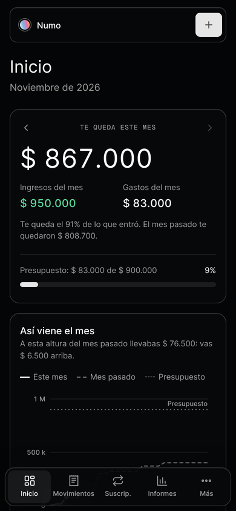
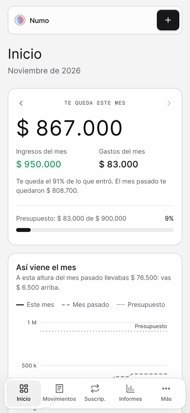
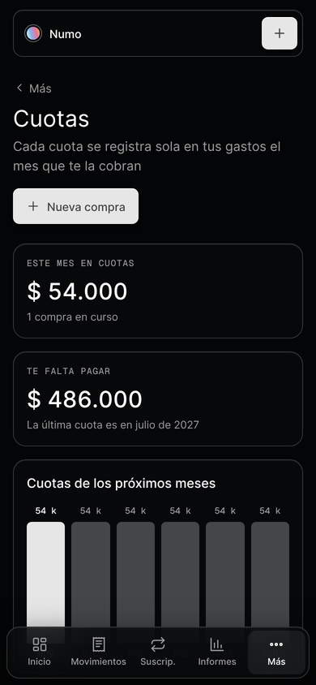
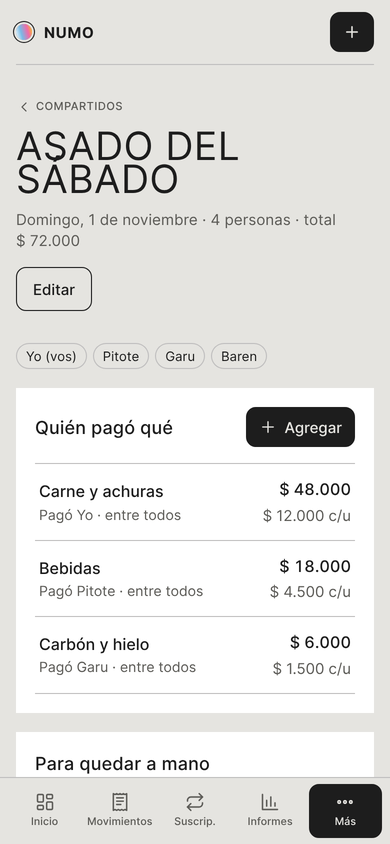

# Numo

Una app web para ordenar tu plata: ingresos, gastos, suscripciones, cuotas, próximos pagos e informes. Pensada para Argentina, con dólar tarjeta, inflación del INDEC y gastos compartidos entre amigos.

**Probala:** https://numo-finanzas.netlify.app

<p>
  
  
  
  
</p>

## Qué hace

- **Movimientos:** ingresos y gastos por categoría, con búsqueda y filtros.
- **Suscripciones y próximos pagos:** calendario de lo que se viene y cuánto queda del mes.
- **Cuotas:** cargás una compra en 3, 6 o 12 cuotas y cada mes aparece sola.
- **Dólar tarjeta:** los gastos en dólares suman el recargo (30% por defecto, editable).
- **Inflación:** compara tus gastos con el IPC del INDEC para ver si gastás más en términos reales.
- **Gastos compartidos:** quién pagó qué en un viaje o una salida y quién le transfiere a quién, con el resumen listo para mandar.
- **Informes:** gráficos por categoría y por mes, presupuesto y comparación con el mes anterior.
- **Tema claro, oscuro o el del sistema.**
- **Funciona sin internet** (PWA instalable) y, si creás una cuenta, se sincroniza entre dispositivos.

## Stack

| Parte | Qué se usa |
| --- | --- |
| Interfaz | JavaScript con módulos ES, sin framework; HTML escapado por defecto |
| Estilos | CSS con tokens de diseño (`src/styles/tokens.css`) para los dos temas |
| Build | [Vite](https://vite.dev) |
| Datos en la nube | [Supabase](https://supabase.com): Auth + Postgres con Row Level Security |
| Hosting | [Netlify](https://www.netlify.com) |
| Pruebas | [Vitest](https://vitest.dev) (unitarias) y [Playwright](https://playwright.dev) (de punta a punta) |
| CI | GitHub Actions |

## Estructura

```
src/
  lib/      utilidades, fechas, almacenamiento, HTML seguro
  core/     lógica de negocio: plata, validación, cuotas, inflación, gastos compartidos
  sync/     guardado local, nube (Supabase) y copias de seguridad
  ui/       componentes, gráficos, calendario, tema, gestos
  views/    una pantalla por archivo (inicio, movimientos, informes…)
  forms/    formularios de carga
  app/      estado, rutas y eventos
  styles/   tokens.css + estilos por capa
public/     manifest, íconos, cabeceras de seguridad (_headers), config.js
tests/
  unit/     lógica pura (finanzas, fechas, validación…)
  e2e/      la app real en un navegador, con Supabase simulado
supabase/   SQL de la tabla, las políticas y la función de borrar cuenta
scripts/    build de la versión de un solo archivo, service worker y servidor local
```

## Cómo correrla

Necesitás Node 24 o más nuevo (está en `.nvmrc`).

```bash
npm install
npm run dev          # servidor de desarrollo
npm test             # pruebas unitarias
npm run test:e2e     # pruebas en el navegador (arma la app y la sirve sola)
npm run build        # versión web en dist/
npm run build:artifact   # versión de un solo archivo en dist-artifact/
```

Para las pruebas de punta a punta, la primera vez: `npx playwright install chromium`.

## Publicación

Netlify está conectado a este repositorio: cada push a `main` corre `npm run build` y publica `dist/`. GitHub Actions corre todas las pruebas en cada cambio.

La conexión con Supabase vive en `public/config.js` y usa solo la clave **publicable**, que está pensada para ir en el navegador. La clave secreta nunca entra al repo.

## Seguridad

- **Cada usuario ve solo lo suyo:** la tabla `numo_docs` tiene Row Level Security; las políticas están en `supabase/schema.sql`.
- **Política de contenido estricta** (`public/_headers`): solo scripts propios, conexiones solo a Supabase, sin iframes, HSTS.
- **Todo el texto que carga el usuario se escapa** antes de mostrarse, y los datos se validan al leerlos.
- **Borrar la cuenta** elimina los datos y el usuario desde la propia app.

## Créditos

Hecha por **Mateo Copello**, con Claude como copiloto.
